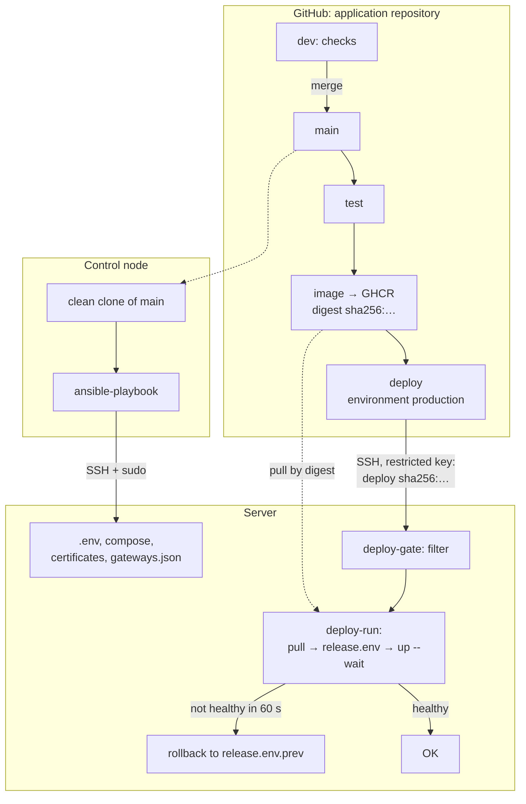
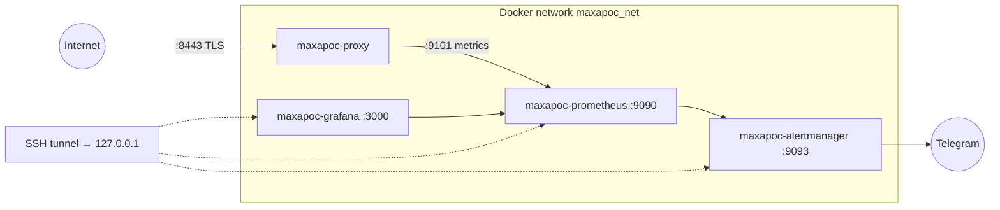

# maxapoc-infra

[Русский](README.md) | **English**

Ansible code that brings an Ubuntu 24.04 server to the working state of the MaxApoc project in one command: baseline setup and hardening, Docker, the application proxy, deploy access for CI, a monitoring stack (Prometheus, Alertmanager → Telegram, Grafana) and encrypted backups. A repeat run changes nothing (`changed=0`).

New proxy versions are rolled out by the CI of the MaxApoc repository (merge to `main` → tests → image → deploy by digest with a health check and automatic rollback). Ansible prepares the server; the deploy owns the version.



**Verified**
- clean virtual machine (VM) → production server in one command in ~6.5 minutes, repeat run `changed=0`;
- the production server was migrated to this code from manual setup; deploy from CI — confirmation ~7 s, downtime ~1 s;
- a production server backup was restored to a clean VM and compared with the live server.

## Documentation

- [DECISIONS](docs/en/DECISIONS.md) — decisions and their reasons
- [OPERATIONS](docs/en/OPERATIONS.md) — maintenance, deploy, backups, restore, incidents
- [SECURITY](docs/en/SECURITY.md) — threat model, accepted risks, limitations

## What the playbook does

`ansible/site.yml` updates a clean clone of MaxApoc to `main` on the control node (compose, `gateways.json` and monitoring files are taken from there) and applies the roles:

| Role | What it does |
|---|---|
| `common` | OS check, base packages, time zone, swap |
| `security` | SSH by key only and not as root; ufw: "deny incoming", rate-limited SSH, ports from a list |
| `docker` | official repository, pinned versions, `live-restore` |
| `backup` | restic → S3 daily, SQLite database snapshots, failure alert (`backup_enabled`) |
| `maxapoc_proxy` | project Docker network, compose, `.env`, certificates, image registry login; on a server with no version — the version from the latest backup |
| `maxapoc_deploy_access` | deploy user with a restricted key (`maxapoc_deploy_access_enabled`) |
| `maxapoc_monitoring` | Prometheus, Alertmanager, Grafana with health checks (`maxapoc_monitoring_enabled`) |



### Environments

| | Test environment (`test`) | Production server (`prod`) |
|---|---|---|
| Inventory | `inventory/test` — default | `inventory/prod` — explicit only, `-i inventory/prod` |
| Vault password, deploy key, registry token, backup repository | separate | separate |
| Monitoring stack | enabled | can be disabled when memory is short (`maxapoc_monitoring_enabled: false`), exposing metrics to an external Prometheus (`maxapoc_proxy_metrics_bind`) |
| HTTP proxy for downloads | if needed (step 7) | no |
| Deploying a new version | manually from the control node | CI on merge to `main` |

## Running from scratch

### 1. Control node

- `ansible-core` 2.18 or newer;
- SSH access to the MaxApoc repository on GitHub (the playbook maintains the clone `~/.cache/maxapoc/app` itself);
- Ansible Vault passwords (step 3).

### 2. Target server

- Ubuntu Server 24.04, 1 GB of memory or more, `openssh-server`;
- a user with sudo (not root), SSH key login:

```bash
ssh-copy-id -i <public_key> <user>@<server_address>
ssh -o PasswordAuthentication=no <user>@<server_address> id    # key-only login works
```

- access to Ubuntu mirrors, `download.docker.com`, Docker Hub, `ghcr.io`, `api.telegram.org` (or step 7).

> The `security` role disables root and password login. If something is already running on the server, the first run is a migration: [OPERATIONS](docs/en/OPERATIONS.md), section 3.

### 3. Ansible Vault passwords

Each environment has its own password (vault IDs `test` and `prod`); paths are in `ansible.cfg`.

```bash
cd ansible && mkdir -p vault-secrets
nano vault-secrets/.test_vault_pass      # from the password manager
nano vault-secrets/.prod_vault_pass
chmod 600 vault-secrets/.*_vault_pass
```

The `vault-secrets/` directory is in `.gitignore`. Keep copies of the passwords in a password manager: a lost password cannot be recovered.

### 4. Inventory

```
ansible/
├── ansible.cfg                 # inventory = ./inventory/test
├── site.yml                    # hosts: maxapoc_servers
├── group_vars/all.yml          # shared by environments
└── inventory/<environment>/
    ├── hosts
    └── host_vars/<host>/       # vars.yml, vault.yml
```

`inventory/<environment>/hosts`:

```ini
[test]
maxapoc-test

[maxapoc_servers:children]
test

[all:vars]
ansible_python_interpreter=/usr/bin/python3
```

`group_vars/all.yml`:

```yaml
maxapoc_repo_clone: "{{ lookup('env', 'HOME') }}/.cache/maxapoc/app"
maxapoc_repo_version: main
maxapoc_proxy_src: "{{ maxapoc_repo_clone }}/proxy"
maxapoc_monitoring_stack_src: "{{ maxapoc_repo_clone }}/observability"
maxapoc_network_name: maxapoc_net
backup_s3_endpoint: "{{ vault_backup_s3_endpoint }}"
backup_s3_bucket: "{{ vault_backup_s3_bucket }}"
backup_s3_region: <region>
proxy_env: {}
```

`host_vars/<host>/vars.yml`:

```yaml
ansible_host: "{{ vault_ansible_host }}"
ansible_user: "{{ vault_ansible_user }}"
ansible_ssh_private_key_file: "{{ vault_ansible_ssh_private_key_file }}"
common_swap_size_mb: 512

security_ufw_allowed_ports:
  - { name: Maxapoc-proxy, proto: tcp, port: 8443 }
  - { name: Zabbix-hoster-1, proto: tcp, port: 10050, src: "{{ vault_hoster_zabbix_addrs[0] }}" }

# maxapoc_proxy_metrics_bind: <address>          # default 127.0.0.1
# maxapoc_monitoring_enabled: false
maxapoc_proxy_image: ghcr.io/<owner>/maxapoc-proxy@sha256:<digest>   # fallback initial version
maxapoc_proxy_registry_token: "{{ vault_maxapoc_proxy_registry_token }}"

maxapoc_deploy_access_enabled: true
maxapoc_deploy_pubkey: "ssh-ed25519 AAAA… maxapoc-deploy@<environment>-ci"

backup_enabled: true
backup_repo_name: <test|prod>
backup_s3_access_key: "{{ vault_backup_s3_access_key }}"
backup_s3_secret_key: "{{ vault_backup_s3_secret_key }}"
backup_restic_password: "{{ vault_backup_restic_password }}"
backup_sqlite_dbs: []            # [{ src: /path/to/database.db, name: snapshot.db }]
backup_paths:
  - /opt/maxapoc/proxy/vps/release.env
backup_alert_telegram_token: "{{ maxapoc_monitoring_telegram_token }}"
backup_alert_telegram_chat_id: "{{ maxapoc_monitoring_telegram_chat_id }}"

# Application repositories
maxapoc_repo_url: "{{ vault_maxapoc_repo_url }}"
maxapoc_proxy_gh_app_repo: "{{ vault_maxapoc_proxy_gh_app_repo }}"
maxapoc_proxy_gh_hub_repo: "{{ vault_maxapoc_proxy_gh_hub_repo }}"

# References to secrets in vault.yml
maxapoc_proxy_gh_app_token: "{{ vault_maxapoc_proxy_gh_app_token }}"
maxapoc_proxy_app_key: "{{ vault_maxapoc_proxy_app_key }}"
maxapoc_proxy_llm_odirouter_key: "{{ vault_maxapoc_proxy_llm_odirouter_key }}"
maxapoc_proxy_llm_routeway_key: "{{ vault_maxapoc_proxy_llm_routeway_key }}"
maxapoc_proxy_gh_hub_token: "{{ vault_maxapoc_proxy_gh_hub_token }}"
maxapoc_proxy_server_crt: "{{ vault_maxapoc_proxy_server_crt }}"
maxapoc_proxy_server_key: "{{ vault_maxapoc_proxy_server_key }}"
maxapoc_proxy_ca_crt: "{{ vault_maxapoc_proxy_ca_crt }}"
maxapoc_monitoring_telegram_token: "{{ vault_maxapoc_monitoring_telegram_token }}"
maxapoc_monitoring_telegram_chat_id: "{{ vault_maxapoc_monitoring_telegram_chat_id }}"
maxapoc_monitoring_grafana_admin_password: "{{ vault_maxapoc_monitoring_grafana_admin_password }}"
```

Defaults are in `roles/<role>/defaults/main.yml`.

`host_vars/<host>/vault.yml` — created encrypted:

```bash
ansible-vault create --encrypt-vault-id test inventory/test/host_vars/maxapoc-test/vault.yml
```

| Variable | What it is |
|---|---|
| `vault_ansible_host`, `vault_ansible_user`, `vault_ansible_ssh_private_key_file` | server address, SSH user and key |
| `vault_hoster_zabbix_addrs` | addresses of the hosting provider's Zabbix agent (list), if any |
| `vault_maxapoc_repo_url` | application repository address for the clone (`git@github.com:…`) |
| `vault_maxapoc_proxy_gh_app_repo`, `vault_maxapoc_proxy_gh_hub_repo` | `owner/name` of the application and hub repositories |
| `vault_backup_s3_endpoint`, `vault_backup_s3_bucket` | S3 storage address and backup bucket |
| `vault_maxapoc_proxy_gh_app_token` | GitHub token for the application repository |
| `vault_maxapoc_proxy_gh_hub_token` | GitHub token for the hub repository |
| `vault_maxapoc_proxy_app_key` | application key, 16 characters or more (`openssl rand -hex 24`) |
| `vault_maxapoc_proxy_llm_odirouter_key`, `vault_maxapoc_proxy_llm_routeway_key` | AI gateway keys |
| `vault_maxapoc_proxy_server_crt`, `_server_key`, `_ca_crt` | proxy certificates (step 5) |
| `vault_maxapoc_proxy_registry_token` | GitHub token (classic), `read:packages` only |
| `vault_maxapoc_monitoring_telegram_token`, `_chat_id` | alert bot and chat |
| `vault_maxapoc_monitoring_grafana_admin_password` | Grafana `admin` password |
| `vault_backup_s3_access_key`, `vault_backup_s3_secret_key` | S3 bucket keys |
| `vault_backup_restic_password` | backup password — **a copy must be kept in a password manager** |

The test environment has its own values, including its own CA, bot and chat. To check that a secret is wired in without printing it (`ansible-inventory --host` prints decrypted secrets):

```bash
ansible -i inventory/prod maxapoc-prod -m debug -a 'msg="{{ vault_maxapoc_proxy_app_key is defined }}"'
```

### 5. Proxy certificates

```bash
<MaxApoc_repository>/proxy/vps/make-certs.sh <server_address> <folder_outside_repository>
```

The contents of `server.crt`, `server.key`, `ca.crt` go into `vault.yml` as multi-line values (`key: |`, lines indented by 2 spaces). `ca.key` stays only in the password manager — not on the server and not in git.

### 6. Collections

```bash
cd ansible && ansible-galaxy collection install -r requirements.yml
```

### 7. HTTP proxy for the test environment (optional)

If the test environment needs outbound access through the control node's proxy (`127.0.0.1:10809`), it can be opened to the test environment network only (`192.168.56.0/24`):

```ini
# /etc/systemd/system/test-proxy.service on the control node
[Service]
ExecStart=/usr/bin/socat TCP-LISTEN:10809,bind=192.168.56.2,reuseaddr,fork TCP:127.0.0.1:10809
Restart=on-failure

[Install]
WantedBy=multi-user.target
```

```yaml
# vars.yml of the test environment host
proxy_env:
  http_proxy: http://192.168.56.2:10809
  https_proxy: http://192.168.56.2:10809
  no_proxy: localhost,127.0.0.1,192.168.56.0/24
backup_alert_proxy: http://192.168.56.2:10809
```

### 8. Run

From the `ansible/` folder:

| | Test environment | Production server |
|---|---|---|
| Preview | `ansible-playbook site.yml --check --diff` | `ansible-playbook -i inventory/prod site.yml --check --diff` |
| Apply | `ansible-playbook site.yml` | `ansible-playbook -i inventory/prod site.yml` |

### 9. Verification

```bash
# proxy: image by digest, healthy, not root
sudo docker inspect maxapoc-proxy --format '{{.Config.Image}} {{.State.Health.Status}}'
sudo docker exec maxapoc-proxy id
# TLS with certificate verification (401 means TLS is fine, the application key is required)
curl --cacert <folder>/ca.crt -I https://<server_address>:8443/
# Docker and backups
sudo docker info --format '{{.LiveRestoreEnabled}}'
systemctl list-timers backup.timer && sudo /usr/local/sbin/restic-env snapshots
# deploy access
ssh -q -o IdentitiesOnly=yes -i <deploy_key> maxapoc-deploy@<server_address> status
```

Monitoring — through the tunnel `ssh -N -L 9090:127.0.0.1:9090 -L 9093:127.0.0.1:9093 -L 3000:127.0.0.1:3000 <user>@<server_address>`:

```bash
curl -s localhost:9090/api/v1/targets | grep -o '"health":"[a-z]*"'                # up
curl -s localhost:9090/api/v1/rules | grep -o '"type":"alerting"' | wc -l           # 20
```

Grafana: `http://localhost:3000`, `admin`, password from vault.

### 10. Deploy from CI (production server)

After the first playbook run:

```bash
ssh-keygen -t ed25519 -f ~/.ssh/maxapoc_deploy_prod -C "maxapoc-deploy@prod-ci" -N ""      # public part → maxapoc_deploy_pubkey
ssh -q <user>@<server_address> cat /etc/ssh/ssh_host_ed25519_key.pub | awk -v h=<server_address> '{print h, $1, $2}'   # → DEPLOY_KNOWN_HOSTS
```

GitHub → Settings → Environments → `production`: `main` branch only; environment secrets `DEPLOY_SSH_KEY`, `DEPLOY_HOST`, `DEPLOY_KNOWN_HOSTS`. To verify, run the `Proxy` workflow manually from `main` (job `deploy-check`). Rollout, rollback and the emergency procedure — [OPERATIONS](docs/en/OPERATIONS.md), sections 5–7.

## Limitations

- Roles are additive only: ufw rules, alert rules and dashboards removed from the lists stay on the server until removed by hand.
- The swap size is applied only when the file is created.
- Docker versions are pinned (`apt-mark hold`); upgrading is a deliberate step, via `roles/docker/defaults/main.yml`.
- Backups run once a day: an incident can lose up to a day of data.
- A new server address requires a new proxy certificate and a new application release: [OPERATIONS](docs/en/OPERATIONS.md), section 9.
- A change that needs both a new variable and new code is released in two steps: [DECISIONS](docs/en/DECISIONS.md#adr-007).
- Other accepted risks — [SECURITY](docs/en/SECURITY.md).
