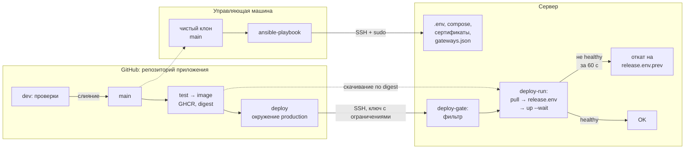
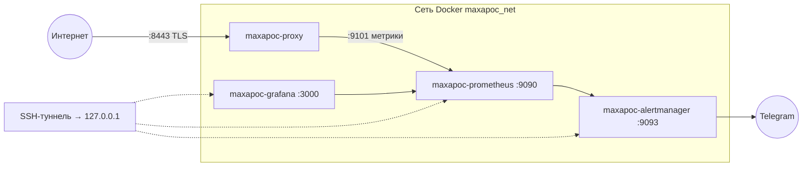

# Архитектура maxapoc-infra
**Русский** | [English](en/ARCHITECTURE.md)

## Компоненты и ответственность

- **Управляющая машина** запускает `ansible/site.yml` по SSH с sudo. Плейбук берёт Docker Compose, `gateways.json` и файлы мониторинга из отдельного чистого клона репозитория приложения. По умолчанию используется `main`; для рабочей среды можно указать коммит, проверенный на тестовой.
- **Сервер Ubuntu 24.04** запускает прокси в Docker. Приложение обращается к нему по TLS на порту 8443. Прокси использует отдельные учётные данные для репозиториев приложения и Хаба и ключи шлюзов ИИ.
- **CI репозитория приложения** тестирует и собирает прокси, публикует образ в GHCR и управляет версией на рабочем сервере. Ansible готовит конфигурацию сервера, сеть, сертификаты и доступ для выкладки.

| Роль | Что делает |
|---|---|
| `common` | проверка ОС, базовые пакеты, часовой пояс, swap |
| `security` | SSH только по ключу и не под root; ufw: «запретить входящие», SSH с ограничением частоты, порты из списка |
| `docker` | официальный репозиторий, закреплённые версии, `live-restore` |
| `backup` | restic → S3 ежедневно, снимки баз SQLite, оповещение о сбое (`backup_enabled`) |
| `maxapoc_proxy` | сеть Docker проекта, compose, `.env`, сертификаты, вход в реестр образов; на сервере без версии — версия из последней копии |
| `maxapoc_deploy_access` | пользователь деплоя с ограниченным ключом (`maxapoc_deploy_access_enabled`) |
| `maxapoc_monitoring` | Prometheus, Alertmanager, Grafana с проверкой здоровья (`maxapoc_monitoring_enabled`) |

## Выкладка прокси

Изменения прокси и его workflow проходят проверки в `dev`. При попадании в `main` CI запускает тесты, собирает образ и передаёт на сервер его digest. Отдельный SSH-ключ ограничен операциями выкладки. Сервер скачивает образ до переключения, сохраняет предыдущую версию и ждёт успешной проверки здоровья до 60 секунд. При неудаче скрипт возвращает предыдущую версию.

Ansible создаёт `release.env` при первичной настройке, если файла ещё нет. Сначала он пытается взять версию из резервной копии окружения. Запасной вариант — начальный образ из инвентаря. Изменение, которое требует новой серверной конфигурации и нового кода прокси, выпускается в два этапа по [ADR-007](docs/DECISIONS.md#adr-007).



## Мониторинг

Если включён локальный стек проекта, Prometheus собирает метрики прокси, Grafana читает их из Prometheus, а Alertmanager отправляет оповещения в Telegram. Доступ к интерфейсам локального стека идёт через SSH-туннель. На рабочем сервере допустимо отключить собственный стек и отдать сбор метрик внешнему Prometheus. В журнале эксплуатации описан такой вариант со стеком `hobot-metrics`.



## Окружения и восстановление

- **Тестовое окружение** использует инвентарь по умолчанию. Версию прокси выкатывают вручную с управляющей машины. При необходимости исходящие загрузки идут через её HTTP-прокси.
- **Рабочее окружение** требует явно указать инвентарь `inventory/prod`. Версию прокси выкатывает CI. У каждого окружения свои секреты и репозиторий резервных копий.
- **Резервные копии** restic сохраняет ежедневно в приватном S3. В копии входят настроенные файлы состояния и снимки указанных баз SQLite. При ежедневном расписании авария может привести к потере изменений за срок до суток. Порядок восстановления описан в [руководстве по эксплуатации](docs/OPERATIONS.md#restore).

В исходной документации зафиксированы развёртывание на чистой ВМ примерно за 6,5 минуты, повторный запуск с `changed=0` и восстановление копии рабочего сервера на отдельной ВМ. Это результаты описанных прогонов.

---

<a id="setup"></a>

## Запуск с нуля

### 1. Управляющая машина

- `ansible-core` 2.18 или новее;
- SSH-доступ к репозиторию MaxApoc на GitHub (плейбук сам ведёт клон `~/.cache/maxapoc/app`);
- пароли Ansible Vault (шаг 3).

### 2. Целевой сервер

- Ubuntu Server 24.04, от 1 ГБ памяти, `openssh-server`;
- пользователь с sudo (не root), вход по SSH-ключу:

```bash
ssh-copy-id -i <публичный_ключ> <пользователь>@<адрес_сервера>
ssh -o PasswordAuthentication=no <пользователь>@<адрес_сервера> id    # вход только по ключу
```

- доступ к зеркалам Ubuntu, `download.docker.com`, Docker Hub, `ghcr.io`, `api.telegram.org` (или шаг 7).

> Роль `security` запрещает вход под root и по паролю. Если на сервере уже что-то работает, первый запуск — миграция: [OPERATIONS](docs/OPERATIONS.md), раздел 3.

### 3. Пароли Ansible Vault

У каждого окружения свой пароль (vault ID `test` и `prod`); пути — в `ansible.cfg`.

```bash
cd ansible && mkdir -p vault-secrets
nano vault-secrets/.test_vault_pass      # из менеджера паролей
nano vault-secrets/.prod_vault_pass
chmod 600 vault-secrets/.*_vault_pass
```

Каталог `vault-secrets/` в `.gitignore`. Копии паролей — в менеджере паролей: потерянный пароль не восстановить.

### 4. Инвентарь

```
ansible/
├── ansible.cfg                 # inventory = ./inventory/test
├── site.yml                    # hosts: maxapoc_servers
├── group_vars/all.yml          # общее для окружений
└── inventory/<окружение>/
    ├── hosts
    └── host_vars/<хост>/       # vars.yml, vault.yml
```

`inventory/<окружение>/hosts`:

```ini
[test]
maxapoc-test

[maxapoc_servers:children]
test

[all:vars]
ansible_python_interpreter=/usr/bin/python3
```

`group_vars/all.yml`:

```yaml
maxapoc_repo_clone: "{{ lookup('env', 'HOME') }}/.cache/maxapoc/app"
maxapoc_repo_version: main
maxapoc_proxy_src: "{{ maxapoc_repo_clone }}/proxy"
maxapoc_monitoring_stack_src: "{{ maxapoc_repo_clone }}/observability"
maxapoc_network_name: maxapoc_net
backup_s3_endpoint: "{{ vault_backup_s3_endpoint }}"
backup_s3_bucket: "{{ vault_backup_s3_bucket }}"
backup_s3_region: <регион>
proxy_env: {}
```

`host_vars/<хост>/vars.yml`:

```yaml
# basic
ansible_host: "{{ vault_ansible_host }}"

# auth
ansible_user: "{{ vault_ansible_user }}"
ansible_ssh_private_key_file: "{{ vault_ansible_ssh_private_key_file }}"

# swap & ufw
common_swap_size_mb: 512
security_ufw_allowed_ports:
  - { name: Maxapoc-proxy, proto: tcp, port: 8443 }
  - { name: Zabbix-hoster-1, proto: tcp, port: 10050, src: "{{ vault_hoster_zabbix_addrs[0] }}" }

# maxapoc_proxy
  # basic
# maxapoc_proxy_metrics_bind: <адрес>            # по умолчанию 127.0.0.1
  #Deploy rules
maxapoc_proxy_image: ghcr.io/<владелец>/maxapoc-proxy@sha256:<digest>   # запасная начальная версия
maxapoc_proxy_registry_token: "{{ vault_maxapoc_proxy_registry_token }}"
  # Certificates
maxapoc_proxy_server_crt: "{{ vault_maxapoc_proxy_server_crt }}"
maxapoc_proxy_server_key: "{{ vault_maxapoc_proxy_server_key }}"
maxapoc_proxy_ca_crt: "{{ vault_maxapoc_proxy_ca_crt }}"
  # App keys
maxapoc_proxy_app_key: "{{ vault_maxapoc_proxy_app_key }}"
  # GitHub Repos
maxapoc_proxy_gh_app_token: "{{ vault_maxapoc_proxy_gh_app_token }}"
maxapoc_proxy_gh_hub_token: "{{ vault_maxapoc_proxy_gh_hub_token }}"
  # LLM-gateway keys
maxapoc_proxy_llm_odirouter_key: "{{ vault_maxapoc_proxy_llm_odirouter_key }}"
maxapoc_proxy_llm_routeway_key: "{{ vault_maxapoc_proxy_llm_routeway_key }}"

# Deploy access (CI)
maxapoc_deploy_access_enabled: true
maxapoc_deploy_pubkey: "ssh-ed25519 AAAA… maxapoc-deploy@<окружение>-ci"

# maxapoc_monitoring_stack
# maxapoc_monitoring_enabled: false
  # Alertmanager
maxapoc_monitoring_telegram_token: "{{ vault_maxapoc_monitoring_telegram_token }}"
maxapoc_monitoring_telegram_chat_id: "{{ vault_maxapoc_monitoring_telegram_chat_id }}"
  # Grafana
maxapoc_monitoring_grafana_admin_password: "{{ vault_maxapoc_monitoring_grafana_admin_password }}"

# Backup
  # basic
backup_enabled: true
backup_paths:
  - /opt/maxapoc/proxy/vps/release.env
  # restic
backup_repo_name: <test|prod>
backup_restic_password: "{{ vault_backup_restic_password }}"
  # S3
backup_s3_access_key: "{{ vault_backup_s3_access_key }}"
backup_s3_secret_key: "{{ vault_backup_s3_secret_key }}"
  # SQLite
backup_sqlite_dbs: []            # [{ src: /путь/к/базе.db, name: снимок.db }]
  # alerting
backup_alert_telegram_token: "{{ maxapoc_monitoring_telegram_token }}"
backup_alert_telegram_chat_id: "{{ maxapoc_monitoring_telegram_chat_id }}"

# Application repositories
maxapoc_repo_url: "{{ vault_maxapoc_repo_url }}"
maxapoc_proxy_gh_app_repo: "{{ vault_maxapoc_proxy_gh_app_repo }}"
maxapoc_proxy_gh_hub_repo: "{{ vault_maxapoc_proxy_gh_hub_repo }}"
```

Значения по умолчанию — в `roles/<роль>/defaults/main.yml`.

`host_vars/<хост>/vault.yml` — создаётся зашифрованным:

```bash
ansible-vault create --encrypt-vault-id test inventory/test/host_vars/maxapoc-test/vault.yml
```

| Переменная | Что это |
|---|---|
| `vault_ansible_host`, `vault_ansible_user`, `vault_ansible_ssh_private_key_file` | адрес сервера, пользователь и ключ SSH |
| `vault_hoster_zabbix_addrs` | адреса агента Zabbix хостера (список), если он есть |
| `vault_maxapoc_repo_url` | адрес репозитория приложения для клона (`git@github.com:…`) |
| `vault_maxapoc_proxy_gh_app_repo`, `vault_maxapoc_proxy_gh_hub_repo` | `владелец/имя` репозиториев приложения и хаба |
| `vault_backup_s3_endpoint`, `vault_backup_s3_bucket` | адрес хранилища S3 и бакет копий |
| `vault_maxapoc_proxy_gh_app_token` | токен GitHub для репозитория приложения |
| `vault_maxapoc_proxy_gh_hub_token` | токен GitHub для репозитория хаба |
| `vault_maxapoc_proxy_app_key` | ключ приложения, от 16 символов (`openssl rand -hex 24`) |
| `vault_maxapoc_proxy_llm_odirouter_key`, `vault_maxapoc_proxy_llm_routeway_key` | ключи шлюзов ИИ |
| `vault_maxapoc_proxy_server_crt`, `_server_key`, `_ca_crt` | сертификаты прокси (шаг 5) |
| `vault_maxapoc_proxy_registry_token` | токен GitHub (classic), только `read:packages` |
| `vault_maxapoc_monitoring_telegram_token`, `_chat_id` | бот и чат оповещений |
| `vault_maxapoc_monitoring_grafana_admin_password` | пароль `admin` в Grafana |
| `vault_backup_s3_access_key`, `vault_backup_s3_secret_key` | ключи бакета S3 |
| `vault_backup_restic_password` | пароль копий — **копия обязательно в менеджере паролей** |

У тестовой среды свои значения, в том числе свой CA, бот и чат. Проверить, что секрет подключён, не выводя его (`ansible-inventory --host` печатает расшифрованные секреты):

```bash
ansible -i inventory/prod maxapoc-prod -m debug -a 'msg="{{ vault_maxapoc_proxy_app_key is defined }}"'
```

### 5. Сертификаты прокси

```bash
<репозиторий_MaxApoc>/proxy/vps/make-certs.sh <адрес_сервера> <папка_вне_репозитория>
```

Содержимое `server.crt`, `server.key`, `ca.crt` — в `vault.yml` многострочными значениями (`key: |`, строки с отступом 2 пробела). `ca.key` — только в менеджере паролей, не на сервер и не в git.

### 6. Коллекции

```bash
cd ansible && ansible-galaxy collection install -r requirements.yml
```

### 7. HTTP-прокси для тестовой среды (необязательно)

Если тестовой среде нужен выход через прокси управляющей машины (`127.0.0.1:10809`), его можно открыть только для сети тестовой среды (`192.168.56.0/24`):

```ini
# /etc/systemd/system/test-proxy.service на управляющей машине
[Service]
ExecStart=/usr/bin/socat TCP-LISTEN:10809,bind=192.168.56.2,reuseaddr,fork TCP:127.0.0.1:10809
Restart=on-failure

[Install]
WantedBy=multi-user.target
```

```yaml
# vars.yml хоста тестовой среды
proxy_env:
  http_proxy: http://192.168.56.2:10809
  https_proxy: http://192.168.56.2:10809
  no_proxy: localhost,127.0.0.1,192.168.56.0/24
backup_alert_proxy: http://192.168.56.2:10809
```

### 8. Запуск

Из папки `ansible/`:

| | Тестовая среда | Рабочий сервер |
|---|---|---|
| Предпросмотр | `ansible-playbook site.yml --check --diff` | `ansible-playbook -i inventory/prod site.yml --check --diff` |
| Применить | `ansible-playbook site.yml` | `ansible-playbook -i inventory/prod site.yml` |

### 9. Проверка

```bash
# прокси: образ по digest, healthy, не root
sudo docker inspect maxapoc-proxy --format '{{.Config.Image}} {{.State.Health.Status}}'
sudo docker exec maxapoc-proxy id
# TLS с проверкой сертификата (401 — TLS в порядке, нужен ключ приложения)
curl --cacert <папка>/ca.crt -I https://<адрес_сервера>:8443/
# Docker и копии
sudo docker info --format '{{.LiveRestoreEnabled}}'
systemctl list-timers backup.timer && sudo /usr/local/sbin/restic-env snapshots
# доступ деплоя
ssh -q -o IdentitiesOnly=yes -i <ключ_деплоя> maxapoc-deploy@<адрес_сервера> status
```

Мониторинг — через туннель `ssh -N -L 9090:127.0.0.1:9090 -L 9093:127.0.0.1:9093 -L 3000:127.0.0.1:3000 <пользователь>@<адрес_сервера>`:

```bash
curl -s localhost:9090/api/v1/targets | grep -o '"health":"[a-z]*"'                # up
curl -s localhost:9090/api/v1/rules | grep -o '"type":"alerting"' | wc -l           # 20
```

Grafana: `http://localhost:3000`, `admin`, пароль из vault.

### 10. Деплой из CI (рабочий сервер)

После первого запуска плейбука:

```bash
ssh-keygen -t ed25519 -f ~/.ssh/maxapoc_deploy_prod -C "maxapoc-deploy@prod-ci" -N ""      # публичная часть → maxapoc_deploy_pubkey
ssh -q <пользователь>@<адрес_сервера> cat /etc/ssh/ssh_host_ed25519_key.pub | awk -v h=<адрес_сервера> '{print h, $1, $2}'   # → DEPLOY_KNOWN_HOSTS
```

GitHub → Settings → Environments → `production`: только ветка `main`; секреты окружения `DEPLOY_SSH_KEY`, `DEPLOY_HOST`, `DEPLOY_KNOWN_HOSTS`. Проверка — ручной запуск workflow `Proxy` с `main` (задача `deploy-check`). Выкладка, откат, аварийный порядок — [OPERATIONS](docs/OPERATIONS.md), разделы 5–7.

## Ограничения

- Роли только добавляют: удалённые из списка правила ufw, правила оповещений и панели остаются на сервере до ручного удаления.
- Размер swap применяется только при создании файла.
- Версии Docker закреплены (`apt-mark hold`); обновление — осознанное, через `roles/docker/defaults/main.yml`.
- Резервная копия — раз в сутки: при аварии теряется до суток данных.
- Новый адрес сервера требует нового сертификата прокси и выпуска приложения: [OPERATIONS](docs/OPERATIONS.md), раздел 9.
- Изменение, которому нужны и новая переменная, и новый код, выпускается в два шага: [DECISIONS](docs/DECISIONS.md#adr-007).
- Остальные принятые риски — [THREAT_MODEL](docs/THREAT_MODEL.md).
