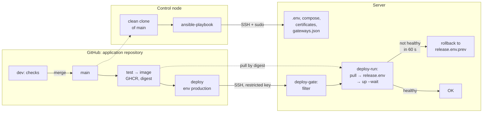
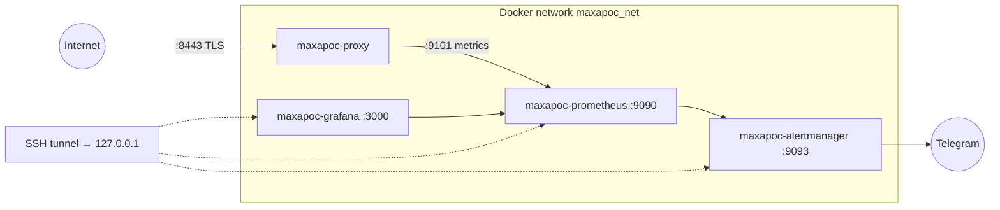

# maxapoc-infra architecture

[Русский](../ARCHITECTURE.md) | **English**

## Components and responsibilities

- **Control node.** Ansible runs `ansible/site.yml` against the server over SSH with sudo. The playbook takes Docker Compose files, `gateways.json`, and monitoring configuration from a separate, clean clone of the application repository. It uses `main` by default. For production, the operator can pin the commit already checked in the test environment.
- **Ubuntu 24.04 server.** Docker runs the application proxy, which serves the app over TLS on port 8443. The proxy uses separate credentials for the app and Hub repositories, plus keys for the AI gateways.
- **Application CI.** CI tests and builds the proxy, publishes its image to GitHub Container Registry (GHCR), and deploys the production image. Ansible manages the server configuration, Docker network, certificates, and deployment access.

| Role | What it does |
|---|---|
| `common` | OS check, base packages, time zone, swap |
| `security` | SSH by key only and not as root; ufw: "deny incoming", rate-limited SSH, ports from a list |
| `docker` | official repository, pinned versions, `live-restore` |
| `backup` | restic → S3 daily, SQLite database snapshots, failure alert (`backup_enabled`) |
| `maxapoc_proxy` | project Docker network, compose, `.env`, certificates, image registry login; initializes the version from the latest backup or the inventory fallback |
| `maxapoc_deploy_access` | deploy user with a restricted key (`maxapoc_deploy_access_enabled`) |
| `maxapoc_monitoring` | Prometheus, Alertmanager, Grafana with health checks (`maxapoc_monitoring_enabled`) |

## Proxy deployment

Changes to the proxy and its workflow go through checks on `dev`. When those changes reach `main`, CI runs tests, builds the image, and sends its digest to the server over SSH using a restricted deployment key. The server pulls the image before switching, saves the previous version, and waits up to 60 seconds for the new container to report healthy. If the health check fails, the deployment script rolls back to the previous version.

Ansible initializes `release.env` if the file is missing. It first tries to restore the version from the environment’s latest backup and falls back to the initial image configured in the inventory. Changes that require both new server configuration and new proxy code use a two-stage rollout. See [ADR-007](docs/en/DECISIONS.md#adr-007).



## Monitoring

When the project’s monitoring stack is enabled, Prometheus collects proxy metrics, Grafana reads them from Prometheus, and Alertmanager sends alerts to Telegram. Operators access the monitoring interfaces over an SSH tunnel. Production can use an external Prometheus instead. The [operations guide](docs/en/OPERATIONS.md) documents the setup with the `hobot-metrics` stack.



## Environments and recovery

- **Test** uses the default inventory. The operator deploys proxy versions manually from the control node. Downloads can go through the control node’s HTTP proxy if needed.
- **Production** requires explicitly selecting `inventory/prod`. CI deploys proxy versions. Each environment has its own secrets and backup repository.
- **Backups.** Restic writes encrypted daily backups to a private S3 bucket. The backups include the configured state files and SQLite snapshots. With daily backups, an incident can cost up to a day of changes. See the [recovery procedure](docs/en/OPERATIONS.md#restore).

The original README records provisioning a clean VM in about 6.5 minutes, rerunning the playbook with `changed=0`, and restoring a production backup to a separate VM for comparison with the live server.

---

<a id="setup"></a>

## Running from scratch

### 1. Control node

- `ansible-core` 2.18 or newer;
- SSH access to the MaxApoc repository on GitHub (the playbook maintains the clone `~/.cache/maxapoc/app` itself);
- Ansible Vault passwords (step 3).

### 2. Target server

- Ubuntu Server 24.04, 1 GB of memory or more, `openssh-server`;
- a user with sudo (not root), SSH key login:

```bash
ssh-copy-id -i <public_key> <user>@<server_address>
ssh -o PasswordAuthentication=no <user>@<server_address> id    # key-only login
```

- access to Ubuntu mirrors, `download.docker.com`, Docker Hub, `ghcr.io`, `api.telegram.org` (or step 7).

> The `security` role disables root and password login. If something is already running on the server, the first run is a migration: [OPERATIONS](docs/en/OPERATIONS.md), section 3.

### 3. Ansible Vault passwords

Each environment has its own password (vault IDs `test` and `prod`); paths are in `ansible.cfg`.

```bash
cd ansible && mkdir -p vault-secrets
nano vault-secrets/.test_vault_pass      # from the password manager
nano vault-secrets/.prod_vault_pass
chmod 600 vault-secrets/.*_vault_pass
```

The `vault-secrets/` directory is in `.gitignore`. Keep copies of the passwords in a password manager: a lost password cannot be recovered.

### 4. Inventory

```
ansible/
├── ansible.cfg                 # inventory = ./inventory/test
├── site.yml                    # hosts: maxapoc_servers
├── group_vars/all.yml          # shared by environments
└── inventory/<environment>/
    ├── hosts
    └── host_vars/<host>/       # vars.yml, vault.yml
```

`inventory/<environment>/hosts`:

```ini
[test]
maxapoc-test

[maxapoc_servers:children]
test

[all:vars]
ansible_python_interpreter=/usr/bin/python3
```

`group_vars/all.yml`:

```yaml
maxapoc_repo_clone: "{{ lookup('env', 'HOME') }}/.cache/maxapoc/app"
maxapoc_repo_version: main
maxapoc_proxy_src: "{{ maxapoc_repo_clone }}/proxy"
maxapoc_monitoring_stack_src: "{{ maxapoc_repo_clone }}/observability"
maxapoc_network_name: maxapoc_net
backup_s3_endpoint: "{{ vault_backup_s3_endpoint }}"
backup_s3_bucket: "{{ vault_backup_s3_bucket }}"
backup_s3_region: <region>
proxy_env: {}
```

`host_vars/<host>/vars.yml`:

```yaml
# basic
ansible_host: "{{ vault_ansible_host }}"

# auth
ansible_user: "{{ vault_ansible_user }}"
ansible_ssh_private_key_file: "{{ vault_ansible_ssh_private_key_file }}"

# swap & ufw
common_swap_size_mb: 512
security_ufw_allowed_ports:
  - { name: Maxapoc-proxy, proto: tcp, port: 8443 }
  - { name: Zabbix-hoster-1, proto: tcp, port: 10050, src: "{{ vault_hoster_zabbix_addrs[0] }}" }

# maxapoc_proxy
  # basic
# maxapoc_proxy_metrics_bind: <address>            # by default 127.0.0.1
  #Deploy rules
maxapoc_proxy_image: ghcr.io/<owner>/maxapoc-proxy@sha256:<digest>   # fallback initial version
maxapoc_proxy_registry_token: "{{ vault_maxapoc_proxy_registry_token }}"
  # Certificates
maxapoc_proxy_server_crt: "{{ vault_maxapoc_proxy_server_crt }}"
maxapoc_proxy_server_key: "{{ vault_maxapoc_proxy_server_key }}"
maxapoc_proxy_ca_crt: "{{ vault_maxapoc_proxy_ca_crt }}"
  # App keys
maxapoc_proxy_app_key: "{{ vault_maxapoc_proxy_app_key }}"
  # GitHub Repos
maxapoc_proxy_gh_app_token: "{{ vault_maxapoc_proxy_gh_app_token }}"
maxapoc_proxy_gh_hub_token: "{{ vault_maxapoc_proxy_gh_hub_token }}"
  # LLM-gateway keys
maxapoc_proxy_llm_odirouter_key: "{{ vault_maxapoc_proxy_llm_odirouter_key }}"
maxapoc_proxy_llm_routeway_key: "{{ vault_maxapoc_proxy_llm_routeway_key }}"

# Deploy access (CI)
maxapoc_deploy_access_enabled: true
maxapoc_deploy_pubkey: "ssh-ed25519 AAAA… maxapoc-deploy@<окружение>-ci"

# maxapoc_monitoring_stack
# maxapoc_monitoring_enabled: false
  # Alertmanager
maxapoc_monitoring_telegram_token: "{{ vault_maxapoc_monitoring_telegram_token }}"
maxapoc_monitoring_telegram_chat_id: "{{ vault_maxapoc_monitoring_telegram_chat_id }}"
  # Grafana
maxapoc_monitoring_grafana_admin_password: "{{ vault_maxapoc_monitoring_grafana_admin_password }}"

# Backup
  # basic
backup_enabled: true
backup_paths:
  - /opt/maxapoc/proxy/vps/release.env
  # restic
backup_repo_name: <test|prod>
backup_restic_password: "{{ vault_backup_restic_password }}"
  # S3
backup_s3_access_key: "{{ vault_backup_s3_access_key }}"
backup_s3_secret_key: "{{ vault_backup_s3_secret_key }}"
  # SQLite
backup_sqlite_dbs: []            # [{ src: /path/to/base.db, name: snapshot.db }]
  # alerting
backup_alert_telegram_token: "{{ maxapoc_monitoring_telegram_token }}"
backup_alert_telegram_chat_id: "{{ maxapoc_monitoring_telegram_chat_id }}"

# Application repositories
maxapoc_repo_url: "{{ vault_maxapoc_repo_url }}"
maxapoc_proxy_gh_app_repo: "{{ vault_maxapoc_proxy_gh_app_repo }}"
maxapoc_proxy_gh_hub_repo: "{{ vault_maxapoc_proxy_gh_hub_repo }}"
```

Defaults are in `roles/<role>/defaults/main.yml`.

`host_vars/<host>/vault.yml` — created encrypted:

```bash
ansible-vault create --encrypt-vault-id test inventory/test/host_vars/maxapoc-test/vault.yml
```

| Variable | What it is |
|---|---|
| `vault_ansible_host`, `vault_ansible_user`, `vault_ansible_ssh_private_key_file` | server address, SSH user and key |
| `vault_hoster_zabbix_addrs` | addresses of the hosting provider's Zabbix agent (list), if any |
| `vault_maxapoc_repo_url` | application repository address for the clone (`git@github.com:…`) |
| `vault_maxapoc_proxy_gh_app_repo`, `vault_maxapoc_proxy_gh_hub_repo` | `owner/name` of the application and hub repositories |
| `vault_backup_s3_endpoint`, `vault_backup_s3_bucket` | S3 storage address and backup bucket |
| `vault_maxapoc_proxy_gh_app_token` | GitHub token for the application repository |
| `vault_maxapoc_proxy_gh_hub_token` | GitHub token for the hub repository |
| `vault_maxapoc_proxy_app_key` | application key, 16 characters or more (`openssl rand -hex 24`) |
| `vault_maxapoc_proxy_llm_odirouter_key`, `vault_maxapoc_proxy_llm_routeway_key` | AI gateway keys |
| `vault_maxapoc_proxy_server_crt`, `_server_key`, `_ca_crt` | proxy certificates (step 5) |
| `vault_maxapoc_proxy_registry_token` | GitHub token (classic), `read:packages` only |
| `vault_maxapoc_monitoring_telegram_token`, `_chat_id` | alert bot and chat |
| `vault_maxapoc_monitoring_grafana_admin_password` | Grafana `admin` password |
| `vault_backup_s3_access_key`, `vault_backup_s3_secret_key` | S3 bucket keys |
| `vault_backup_restic_password` | backup password — **a copy must be kept in a password manager** |

The test environment has its own values, including its own CA, bot and chat. To check that a secret is wired in without printing it (`ansible-inventory --host` prints decrypted secrets):

```bash
ansible -i inventory/prod maxapoc-prod -m debug -a 'msg="{{ vault_maxapoc_proxy_app_key is defined }}"'
```

### 5. Proxy certificates

```bash
<MaxApoc_repository>/proxy/vps/make-certs.sh <server_address> <folder_outside_repository>
```

The contents of `server.crt`, `server.key`, `ca.crt` go into `vault.yml` as multi-line values (`key: |`, lines indented by 2 spaces). `ca.key` stays only in the password manager — not on the server and not in git.

### 6. Collections

```bash
cd ansible && ansible-galaxy collection install -r requirements.yml
```

### 7. HTTP proxy for the test environment (optional)

If the test environment needs outbound access through the control node's proxy (`127.0.0.1:10809`), it can be opened to the test environment network only (`192.168.56.0/24`):

```ini
# /etc/systemd/system/test-proxy.service on the control node
[Service]
ExecStart=/usr/bin/socat TCP-LISTEN:10809,bind=192.168.56.2,reuseaddr,fork TCP:127.0.0.1:10809
Restart=on-failure

[Install]
WantedBy=multi-user.target
```

```yaml
# vars.yml of the test environment host
proxy_env:
  http_proxy: http://192.168.56.2:10809
  https_proxy: http://192.168.56.2:10809
  no_proxy: localhost,127.0.0.1,192.168.56.0/24
backup_alert_proxy: http://192.168.56.2:10809
```

### 8. Run

From the `ansible/` folder:

| | Test environment | Production server |
|---|---|---|
| Preview | `ansible-playbook site.yml --check --diff` | `ansible-playbook -i inventory/prod site.yml --check --diff` |
| Apply | `ansible-playbook site.yml` | `ansible-playbook -i inventory/prod site.yml` |

### 9. Verification

```bash
# proxy: image by digest, healthy, not root
sudo docker inspect maxapoc-proxy --format '{{.Config.Image}} {{.State.Health.Status}}'
sudo docker exec maxapoc-proxy id
# TLS with certificate verification (401 means TLS is fine, the application key is required)
curl --cacert <folder>/ca.crt -I https://<server_address>:8443/
# Docker and backups
sudo docker info --format '{{.LiveRestoreEnabled}}'
systemctl list-timers backup.timer && sudo /usr/local/sbin/restic-env snapshots
# deploy access
ssh -q -o IdentitiesOnly=yes -i <deploy_key> maxapoc-deploy@<server_address> status
```

Monitoring — through the tunnel `ssh -N -L 9090:127.0.0.1:9090 -L 9093:127.0.0.1:9093 -L 3000:127.0.0.1:3000 <user>@<server_address>`:

```bash
curl -s localhost:9090/api/v1/targets | grep -o '"health":"[a-z]*"'                # up
curl -s localhost:9090/api/v1/rules | grep -o '"type":"alerting"' | wc -l           # 20
```

Grafana: `http://localhost:3000`, `admin`, password from vault.

### 10. Deploy from CI (production server)

After the first playbook run:

```bash
ssh-keygen -t ed25519 -f ~/.ssh/maxapoc_deploy_prod -C "maxapoc-deploy@prod-ci" -N ""      # public part → maxapoc_deploy_pubkey
ssh -q <user>@<server_address> cat /etc/ssh/ssh_host_ed25519_key.pub | awk -v h=<server_address> '{print h, $1, $2}'   # → DEPLOY_KNOWN_HOSTS
```

GitHub → Settings → Environments → `production`: `main` branch only; environment secrets `DEPLOY_SSH_KEY`, `DEPLOY_HOST`, `DEPLOY_KNOWN_HOSTS`. To verify, run the `Proxy` workflow manually from `main` (job `deploy-check`). Rollout, rollback and the emergency procedure — [OPERATIONS](docs/en/OPERATIONS.md), sections 5–7.

## Limitations

- Roles are additive only: ufw rules, alert rules and dashboards removed from the lists stay on the server until removed by hand.
- The swap size is applied only when the file is created.
- Docker versions are pinned (`apt-mark hold`); upgrading is a deliberate step, via `roles/docker/defaults/main.yml`.
- Backups run once a day: an incident can lose up to a day of data.
- A new server address requires a new proxy certificate and a new application release: [OPERATIONS](docs/en/OPERATIONS.md), section 9.
- A change that needs both a new variable and new code is released in two steps: [DECISIONS](docs/en/DECISIONS.md#adr-007).
- Other accepted risks — [THREAT_MODEL](docs/en/THREAT_MODEL.md).
